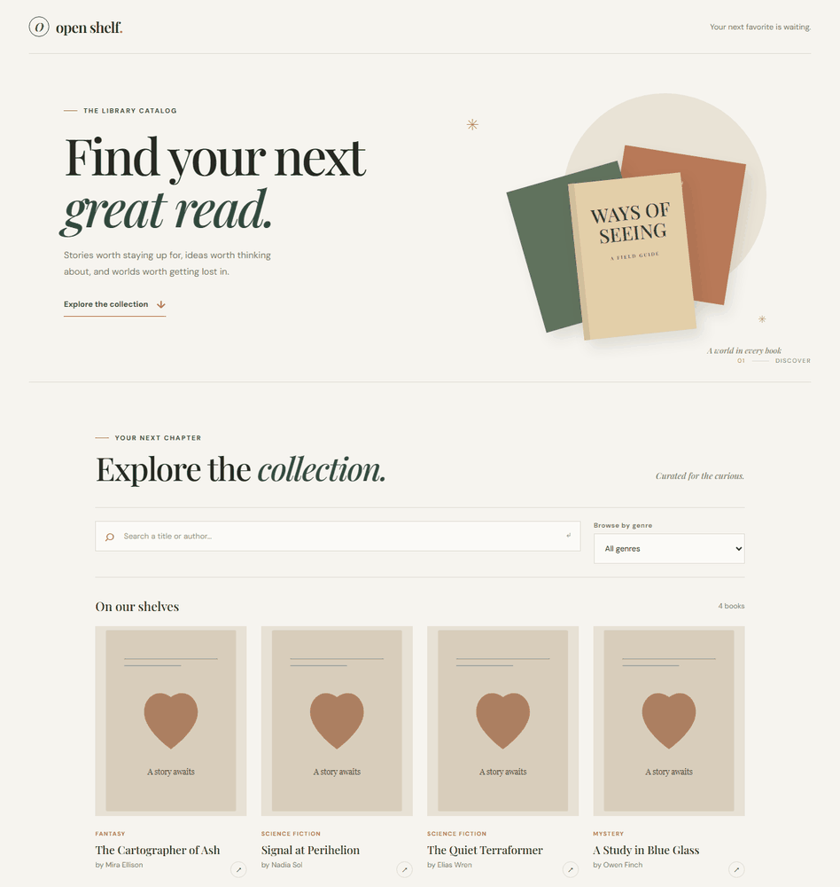

# Open Shelf — Library Catalog

A responsive React catalog for browsing the Library Catalog API. Patrons can search by book title or author, filter by genre, page through results, and open a book for its full details.

## Requirements

- Node.js 20 or newer
- The Library Catalog API running at `http://localhost:3000` (see the backend repository at [Assignment-2](https://github.com/simaloikett-maker/Assignment-2))

## Run locally

```bash
npm install
npm run dev
```

Open the Vite URL printed in your terminal (normally `http://localhost:5173`). During development, Vite proxies `/books` and `/genres` requests to the API at `http://localhost:3000`.

For a deployed API or a different API host, create `.env.local`:

```env
VITE_API_BASE_URL=https://your-api.example.com
```

Then restart the development server. To create and preview a production build:

```bash
npm run build
npm run preview
```

When deploying with browser-history routing, configure the static host to serve `index.html` for frontend routes such as `/books/:id`. Keep the API on a separate host/origin (set `VITE_API_BASE_URL`) so API requests to `/books/:id` do not conflict with the frontend detail route.

## Features

- Responsive book grid, cover art, title, author, and genre
- Genre dropdown populated from `GET /genres`
- Search debounced by 350 ms and matched against title or author
- Book detail pages at `/books/:id`, with a friendly not-found state for malformed IDs and API errors
- Visible loading, error, and empty states for the catalog, genre list, and book detail
- Pagination driven by the API response metadata
- A reading list that can be managed from catalog cards and book detail pages
- Login and registration backed by the API, with booking access restricted to signed-in patrons
- A local-only space booking form for a study room, date, and start/end times

## Reading list and booking persistence

The reading list is stored in browser `localStorage`, so it survives a page refresh without requiring an account or a backend endpoint. It is specific to the current browser and device; clearing browser storage removes it. Space booking form values are currently held only in React state and are not submitted or persisted. The form is intentionally ready for a booking endpoint to be added later.

Authentication uses the API's `HttpOnly` session cookie rather than storing a token in browser JavaScript. Login, registration, and profile requests include credentials. Registration signs the patron in immediately after successful account creation so the protected booking page is available without a second manual login.

The Vite development server also proxies `/api` to the catalog service for the authentication and profile routes.

## Authentication and booking

- `/login` — sign in using an API patron account
- `/register` — create an account; duplicate usernames/emails and other API failures are shown in the form
- `/booking` — protected space booking form
- `/reading-list` — view and manage locally saved books

## Filtering strategy

The client uses the API's `GET /books?genre=<id>&search=<text>&page=<n>&limit=<n>` endpoint rather than downloading the whole catalog. Genre and search parameters stay in the URL and are sent together, so a search remains active when a genre is selected. Updating either filter resets pagination to page 1.

## Demo recording

The animated demo shows browsing, filtering by genre, searching within that genre, and opening a book detail page. It uses sample catalog data matching the API response shape.



## API routes used

- `GET /genres`
- `GET /books` with genre, search, page, and limit query parameters
- `GET /books/:id`
